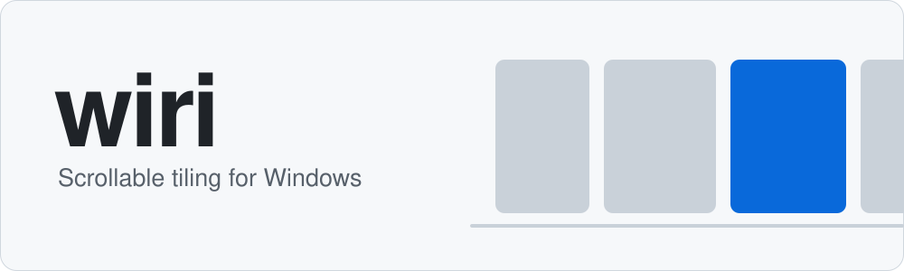
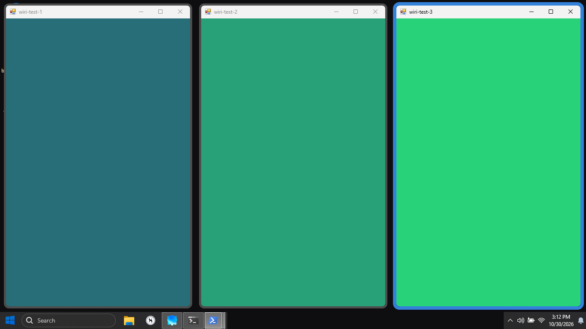
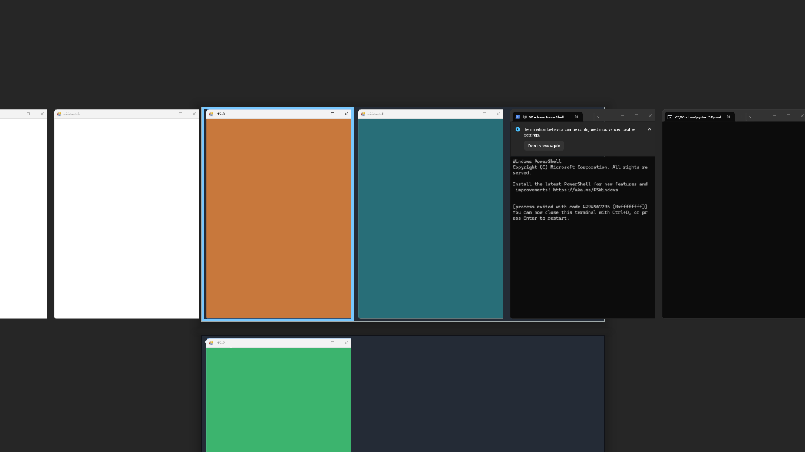
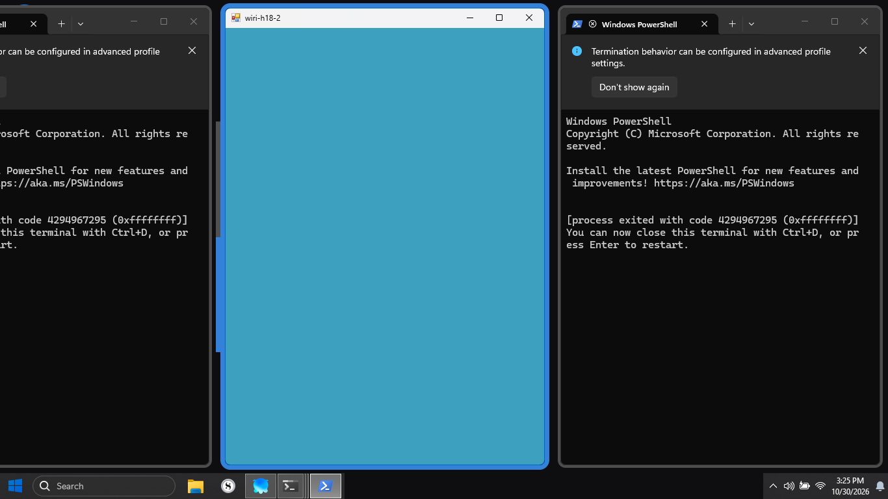
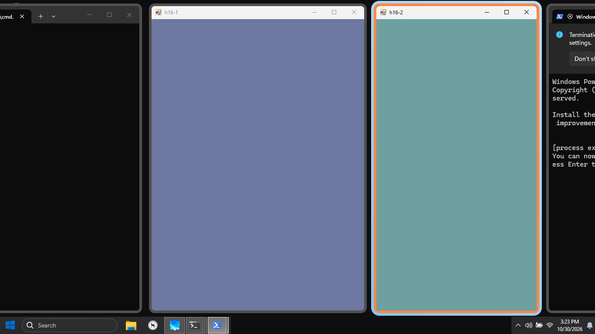
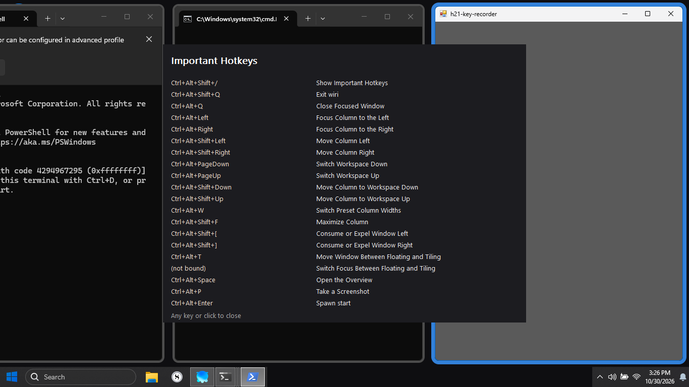
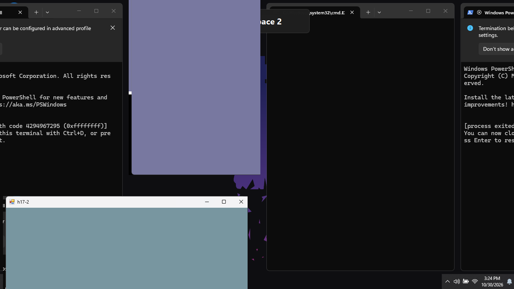

<p align="center">
  <picture>
    <source media="(prefers-color-scheme: dark)" srcset="docs/assets/wiri-banner-dark.svg">
    
  </picture>
</p>

<p align="center">
  wiri is a scrollable-tiling window manager for Windows: windows sit in columns on an endless strip, and opening a new window never resizes the others.
</p>

<p align="center">
  <a href="https://github.com/jolionlands/wiri/actions/workflows/ci.yml"></a>
  <a href="LICENSE"></a>
  
  
</p>

<p align="center">
  
  <br>
  <em>Three columns on the strip, with gaps. The focused window has a blue ring.</em>
</p>

## Status

wiri is a working prototype. It builds for x86_64 and ARM64 Windows. The measurements below come from one x64 laptop, and multi-monitor, mixed-DPI and ARM64 testing on real hardware are still in progress.

## Why wiri

- **niri's model, on Windows.** Windows are columns on an endless strip, and each monitor has its own stack of dynamic workspaces. Opening a window never resizes the others.
- **Light and quick.** Idle CPU measures effectively zero, and a key press has the window in its new place in under 6 ms at the median. See [Performance](#performance).
- **Speaks niri's language.** The config uses niri's KDL syntax, so `binds {}` blocks and `window-rule`s paste in as they are. `wiri-ctl` mirrors `niri msg`, with niri-shaped JSON for windows and workspaces.
- **Tested on a real desktop.** An automated harness sends real keyboard input to real windows and checks the results. Its latest fully green official run passed all 769 enforced checks.

## Screenshots

| | |
| :---: | :---: |
| <br>**Overview.** The workspaces zoomed out, with live window thumbnails. Toggle it with `Ctrl+Alt+Space`. | <br>**Tabbed column.** A tab indicator sits on the column's edge, and the second window is the one shown. |
| <br>**Focus ring and border.** The focused window gets a coloured ring and border. The others keep a grey frame. | <br>**Important Hotkeys.** The overlay lists the bound keys and what they do. Any key or click closes it. |
| <br>**Workspace switch.** Caught mid-animation: the windows slide as the workspace changes. | Screenshots come from the live desktop test harness on a 1366×768 display. |

## Quick start

You need [Rust](https://rustup.rs) and Git. In PowerShell:

```pwsh
git clone https://github.com/jolionlands/wiri.git
cd wiri
cargo build --release
.\target\release\wiri.exe
```

The build produces `target\release\wiri.exe` (the window manager) and `target\release\wiri-ctl.exe` (the command-line client). There is no installer, so copy them to any folder on your PATH.

A tray icon appears. Open a few apps, and each one joins the current workspace's strip. To quit, run `wiri-ctl quit`, use the tray menu, or press `Ctrl+Alt+Shift+Q`. To start wiri with Windows, run `wiri.exe --register-startup`. It writes only to your per-user Run key.

wiri reads its config from `%APPDATA%\wiri\config.kdl`. Edit the file and save, and wiri reloads it. The full walkthrough is in [docs/QUICKSTART.md](docs/QUICKSTART.md).

## Default key bindings

All defaults use **Ctrl+Alt** as the modifier, and you can remap any of them in your config.

| Key combo | Action |
| --- | --- |
| `Ctrl+Alt+←/→` | Focus column left / right |
| `Ctrl+Alt+↑/↓` | Focus up / down within a column |
| `Ctrl+Alt+Shift+←/→` | Move the focused column left / right |
| `Ctrl+Alt+H/L` | Scroll the view left / right (vim-keys) |
| `Ctrl+Alt+1..9` | Switch to workspace N |
| `Ctrl+Alt+Space` | Toggle overview (zoom out) |
| ``Ctrl+Alt+` `` | Focus the previous window |
| `Ctrl+Alt+F` | Toggle fullscreen |
| `Ctrl+Alt+T` | Toggle floating |
| `Ctrl+Alt+Q` | Close the focused window |
| `Ctrl+Alt+Return` | Open `cmd.exe` |
| `Ctrl+Alt+Shift+Q` | Quit wiri |
| `Alt` + left-drag | Interactive move |
| `Alt` + right-drag | Interactive resize at the window edge |

## Configuration

wiri reads [KDL](https://kdl.dev), the config syntax niri uses. This is a trimmed copy of [`examples/minimal.kdl`](examples/minimal.kdl):

```kdl
version "1.0"

input {
    mod-key "ctrl-alt"
}

// Keep wiri's built-in binds. Without extend-defaults, a binds block
// binds only what it lists.
binds {
    extend-defaults
}

layout {
    gaps 12
    column-width 700

    border {
        width 3
        inactive-color "#3c3836"
        active-color "#83a598"
    }
}

animations {
    on
    duration 180
    easing "ease-out-cubic"
}
```

Add your own binds to the same `binds` block. A bind on the same keys as a built-in wins. [`examples/cheatsheet.kdl`](examples/cheatsheet.kdl) binds every action to a memorable chord, which is a good way to learn the keymap. A mistake in the file is reported with its line and column, and the last good config stays in use. For every option, see [docs/DOCUMENTATION.md](docs/DOCUMENTATION.md) (section 4).

## Unified XY grid (opt-in wiri extension)

With `unified-grid` on, the desktop is one 2D grid: every workspace row on a monitor shares one horizontal camera, so moving up or down lands on the column under you, and you can move diagonally in one step. Columns keep their own widths. Without the flag, wiri behaves exactly like niri.

```kdl
layout {
    unified-grid
    unified-grid-chord-ms 150   // two arrows within this window make one diagonal move; 0 turns it off
}

binds {
    Mod+Alt+U { focus-up-left; }
    Mod+Alt+I { focus-up-right; }
    Mod+Alt+J { focus-down-left; }
    Mod+Alt+L { focus-down-right; }
}
```

The same four directions exist as `move-window-up-left` … `move-window-down-right` and `pan-up-left` … `pan-down-right`, from binds, `wiri-ctl action` and IPC. Hold one arrow and press the perpendicular one to make a single diagonal move; a single press never waits. It can be turned on for one monitor only. The full design is in [docs/design/unified-grid.md](docs/design/unified-grid.md).


## Scripting with wiri-ctl

`wiri-ctl` talks to the running daemon over a named pipe. Its output is readable by default, and `--json` gives raw output for scripts.

```pwsh
wiri-ctl state                          # summary of the running daemon
wiri-ctl switch-workspace 3             # jump to workspace 3
wiri-ctl windows --json | jq '.result'  # raw window list, niri-shaped (needs jq)
wiri-ctl events --types '*'             # stream events as they happen
```

## niri parity

wiri is checked against niri's main branch (snapshot of 22 October 2026). Each feature row is checked in the code, not in the docs. At the latest recount, from 30 October 2026:

- **309 of 397** applicable features are done (77.8%), **88** are partial, and **none** are missing. Rows move to done only after their live checks pass in a full desktop run.
- All **143** niri actions are recognised. The nine that are specific to Wayland compositors return an explicit error.

Row-by-row status and open items are in [docs/parity/README.md](docs/parity/README.md).

## Performance

These figures come from one Windows 11 x64 laptop (Intel Core i5-8350U, 1366×768 display at 96 DPI). Each figure is from a single run, with synthetic keyboard input.

| What | Result |
| --- | --- |
| Idle CPU over 30 seconds | 0 ms, below the counter's 15.6 ms resolution |
| Key press to window repositioned (10 keys, timed at the target window) | median 5.85 ms, max 7.54 ms |
| Launch to first tiled layout | about 64 ms (one cold start) |
| Animation frame interval | 16.7 ms (60 Hz), about 0.13 ms of CPU per frame |
| Memory at rest | about 4.4 MiB private, 17.8 MiB working set |

The key-press figure runs from the real `SendInput` call to the moved window's own UI thread receiving its new position, so it excludes only drawing the frame. The memory figures come from the same measured run ([details](docs/parity/2026-10-29-tridaris-r4.md#owned-target-acknowledgement-performance)). These are x64 numbers, and ARM64 measurements are still to come. The method and the raw numbers are in [docs/PERF.md](docs/PERF.md).

## Coming soon

These are in progress:

- **Pannable overview.** The overview becomes niri's fixed-zoom view of the endless grid, which you can pan.
- **Unified XY grid in the overview.** The [unified grid](#unified-xy-grid-opt-in-wiri-extension) works in the normal view; the overview will draw it with the same shared camera.
- **Multi-monitor and mixed-DPI checks** on real hardware.
- **ARM64 performance numbers.**

## Known limits

- Fullscreen-exclusive games cannot be tiled (no compositor can).
- Some UWP apps expose limited window control.
- Some anti-cheat tools dislike the low-level mouse hook that Alt+drag uses.
- Windows reserves some key combinations, such as `Ctrl+Alt+Tab`, so wiri cannot bind them. See [TROUBLESHOOTING](docs/TROUBLESHOOTING.md).

## Documentation

- [Quick start](docs/QUICKSTART.md): install, run, keys, config, scripting and autostart
- [Documentation](docs/DOCUMENTATION.md): every config option and the module reference
- [Architecture](docs/SPEC.md): the design and module overview
- [IPC protocol](docs/IPC_PROTOCOL.md): the protocol behind `wiri-ctl`
- [Troubleshooting](docs/TROUBLESHOOTING.md)
- [Comparison](docs/COMPARISON.md): wiri next to niri, komorebi and FancyZones
- [Performance](docs/PERF.md) and [niri parity](docs/parity/README.md)

## Contributing

Pull requests and issues are welcome. Build with `cargo build --release`, test with `cargo test --release --no-fail-fast`, and check with `cargo check --release --all-targets` (CI treats warnings as errors). [CONTRIBUTING.md](CONTRIBUTING.md) has the details, and the bug and feature templates are in `.github/ISSUE_TEMPLATE/`.

## License

wiri is MIT licensed. See [LICENSE](LICENSE).

## Acknowledgements

wiri takes its model from [niri](https://github.com/YaLTeR/niri) by Ivan Molodetskikh and its contributors, including the scrollable-tiling idea, the KDL config and much of the vocabulary. wiri is a separate Windows project, and thanks go to the niri team for the design.
